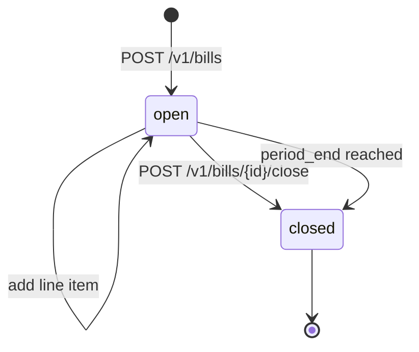
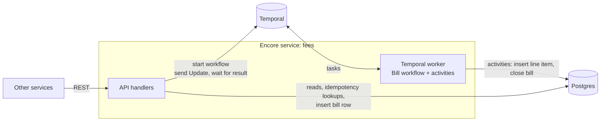

# Fees API: design

A service that accrues fees on a bill over a billing period and charges the
total when the period closes. Built on Encore (API, infrastructure), Temporal
(one workflow per bill) and Postgres (the record).

## 1. Functional requirements

| # | Requirement |
|---|---|
| F1 | Create a bill at the start of a billing period. This starts the bill's workflow. |
| F2 | Add line items to an open bill. |
| F3 | Close a bill. The response states the total charged and the line items charged. Line items are paged: up to 100 in the response, the rest behind a page token (section 4, "Close"). |
| F4 | Reject a line item once the bill is closed. |
| F5 | Bills are in GEL or USD. |
| F6 | A bill closes itself when its period ends, if nobody closed it earlier. |
| F7 | Read a bill at any time, with its line items and the total accrued so far. |
| F8 | Every write can be retried safely with an `Idempotency-Key`. |
| F9 | List a customer's bills, and page through a bill's line items. |

F1 to F5 are the brief. F6 to F9 are additions: a fee period that never ends
without a manual call is not a period, callers need to see what is accruing,
a financial API that double-charges on a network retry is not usable, and a
bill that accrues for a month cannot return every line item in one response.

Out of scope, on purpose: authentication, currency conversion, credits or negative line items, and the actual charge against an
account. Section 6.8 says how each would be added.

## 2. Non-functional requirements

| # | Requirement | How it is met |
|---|---|---|
| N1 | Money is exact. | Integer minor units everywhere; no float at any layer (6.1). |
| N2 | A closed bill charges exactly the line items whose callers were told "accepted". Nothing lost, nothing added later. | One workflow per bill orders every add against the close; row locks back it up in Postgres (6.3). |
| N3 | Retries never double-charge. | Idempotency keys enforced by a unique constraint (6.4). |
| N4 | A bill survives process crashes and deploys, including a period-end timer weeks away. | Temporal persists workflow state and timers. |
| N5 | A closed bill is immutable and explainable. | Total and closing time are written once; line items are append-only and each carries the time it was accepted. |
| N6 | Scale out by adding bills, not by making one bill faster. | Bills are independent workflows and independent rows; API and workers are stateless (6.7). |

Assumed load: many bills, each with a modest write rate (fees accrue as a
customer transacts: single digits per second per bill at most, thousands of
line items per period).

## 3. Entities

**Bill**

| Field | Type | Notes |
|---|---|---|
| `id` | `bill_<uuidv7>` | Also the Temporal workflow ID. |
| `customer_id` | string | Opaque reference to whoever is billed. |
| `currency` | `GEL` \| `USD` | Fixed at creation. |
| `status` | `open` \| `closed` | |
| `period_end` | timestamp | When the bill closes itself. |
| `total_amount` | minor units | Final when closed; running sum while open. |
| `created_at`, `closed_at` | timestamp | `closed_at` is null while open. |

**Line item**

| Field | Type | Notes |
|---|---|---|
| `id` | `line_item_<uuidv7>` | |
| `bill_id` | bill ID | |
| `description` | string | |
| `amount` | minor units, > 0 | |
| `currency` | same as the bill | Enforced by a composite foreign key. |
| `created_at` | timestamp | Workflow time when the item was accepted. |

**State machine**



There are two public states and one transition, and it is one-way. Inside the
workflow there is a third, short-lived state, `closing`: new line items are
already rejected, while line items accepted a moment earlier finish being
written so that they are part of the total.

The schema states the same rules as constraints
(`fees/migrations/1_create_bills.up.sql`): a bill has a total and a closing
time exactly when it is closed, amounts are positive, and a line item cannot
reference a bill in another currency.

## 4. API

Conventions follow Pave Bank's public API docs: `/v1` prefix, snake_case
fields, prefixed IDs, lowercase status values, amounts as strings of minor
units, and a required `Idempotency-Key` header on writes. Timestamps are
RFC 3339.

| Method and path | Purpose | Success |
|---|---|---|
| `POST /v1/bills` | Create a bill and start its workflow | `201` bill |
| `GET /v1/bills?customer_id=` | List a customer's bills, newest first | `200` page of bills |
| `GET /v1/bills/{id}` | Read a bill with its first page of line items | `200` bill |
| `POST /v1/bills/{id}/line-items` | Add a line item | `201` line item |
| `GET /v1/bills/{id}/line-items` | Page through a bill's line items, oldest first | `200` page of line items |
| `POST /v1/bills/{id}/close` | Close the bill | `200` bill |

Closing is `POST` on a sub-resource, not `PUT` or `DELETE`: it is a one-way
transition with side effects, not a replacement or removal of the bill.
Closing an already closed bill returns the same closed bill, so the call is
naturally idempotent and needs no key.

**Create a bill**

```http
POST /v1/bills
Idempotency-Key: 6f1c1a0e-7d4b-4a5e-9a51-1f0b3a0d9c11

{"customer_id": "customer_42", "currency": "USD", "period_end": "2026-12-01T00:00:00Z"}
```

```json
{
  "id": "bill_019a9c2e5b7a7c3e9d3f5a1b2c3d4e5f",
  "customer_id": "customer_42",
  "currency": "USD",
  "status": "open",
  "period_end": "2026-12-01T00:00:00Z",
  "created_at": "2026-11-01T09:00:00.123456Z",
  "closed_at": null,
  "total_amount": "0",
  "line_items": {"data": [], "next_page_token": ""}
}
```

**Add a line item** (`"1050"` in USD is $10.50)

```http
POST /v1/bills/bill_019a9c2e5b7a7c3e9d3f5a1b2c3d4e5f/line-items
Idempotency-Key: 0b5c9f6e-3d0c-4d53-8a55-0f9d1f1c2a77

{"description": "SWIFT transfer fee", "amount": "1050", "currency": "USD"}
```

```json
{
  "id": "line_item_019a9c2f0c117e0a8b6d4c3b2a190807",
  "bill_id": "bill_019a9c2e5b7a7c3e9d3f5a1b2c3d4e5f",
  "description": "SWIFT transfer fee",
  "amount": "1050",
  "currency": "USD",
  "created_at": "2026-11-03T14:21:07.004211Z"
}
```

**Close** returns the bill with `"status": "closed"`, `closed_at` set, the
final `total_amount`, and its line items.

```json
{
  "id": "bill_019a9c2e5b7a7c3e9d3f5a1b2c3d4e5f",
  "status": "closed",
  "closed_at": "2026-12-01T00:00:00.004211Z",
  "total_amount": "1345",
  "line_items": {
    "data": [
      {"id": "line_item_019a9c2f0c117e0a8b6d4c3b2a190807", "description": "SWIFT transfer fee", "amount": "1050", "currency": "USD", "...": "..."},
      {"id": "line_item_019a9c2f1d227f1b9c7e5d4c3b2a1908", "description": "Account maintenance", "amount": "295", "currency": "USD", "...": "..."}
    ],
    "next_page_token": ""
  }
}
```

The brief asks for "all the line items" on close. How that is met depends on
the size of the bill:

| Bill | What the close response holds |
|---|---|
| Up to 100 line items | Every line item. `next_page_token` is empty, which is the statement that nothing is missing. |
| More than 100 | The first 100, and a `next_page_token`. The caller reads the rest from `GET /v1/bills/{id}/line-items?next_page_token=...` until the token comes back empty. |

In both cases `total_amount` is the sum of every line item on the bill, not of
the ones in the response. The alternative, returning every line item
unpaged, has no upper bound on the response: a bill that accrued a fee per
transaction for a month could be hundreds of megabytes, built in memory on
every close and every read. The closed bill no longer changes, so paging
through it returns exactly the items the total was computed from.

**Lists and pagination** follow the shape of Pave's list endpoints: `page_size`
and `next_page_token` query parameters, and a `{"data": [...],
"next_page_token": "..."}` envelope. An empty `next_page_token` means the last
page. `page_size` defaults to 100; above 1000 is rejected.

```http
GET /v1/bills/bill_019a9c2e5b7a7c3e9d3f5a1b2c3d4e5f/line-items?page_size=2&next_page_token=line_item_019a9c2f0c117e0a8b6d4c3b2a190807
GET /v1/bills?customer_id=customer_42&status=open&page_size=50
```

A bill embeds the first page of its line items in the same envelope, so a
bill of up to 100 line items, closed or open, is complete in one response,
and a larger one says so through `next_page_token`. `total_amount` always
covers every line item, not the page. Bills in a list carry no line items.

Pagination is by cursor (keyset), not by offset: the token is the ID of the
last row returned, and the next page is `WHERE id > token ORDER BY id LIMIT
n` (`id < token ... DESC` for bills, which list newest first). An offset
would re-scan every skipped row on each page. IDs are UUIDv7 generated when
the request arrives, so ordering by ID is ordering by arrival time, and one
index per list (`(bill_id, id)`, `(customer_id, id)`) serves both the filter
and the order. Clients must treat the token as opaque.

Limits, both on open bills only: a line item whose write commits after a
later-arriving one can be missed by a reader who has already paged past its
position, and `total_amount` and the embedded page come from two statements,
so an add landing between them shows in one and not the other. A closed bill
no longer changes, so paging through it is exact. That is the statement that
matters.

**Errors** use Encore's envelope: `{"code": "...", "message": "...", "details": null}`.

| Situation | HTTP | `code` |
|---|---|---|
| Missing or malformed field, unsupported currency, amount not a positive whole number | 400 | `invalid_argument` |
| Line item currency differs from the bill's | 400 | `invalid_argument` |
| `Idempotency-Key` reused with a different payload | 400 | `invalid_argument` |
| Line item added to a closed bill | 400 | `failed_precondition` |
| Unknown bill | 404 | `not_found` |
| Temporal or Postgres unreachable | 503 | `unavailable` |

A server-side failure never carries its cause to the caller. A middleware
(`fees/middleware.go`) logs the full error and answers with the code and a
fixed message; only `invalid_argument`, `not_found` and `failed_precondition`
keep theirs.

"Bill is closed" is `failed_precondition`, which Encore maps to 400. Many REST
APIs would use 409 here. I kept 400 because the code names the situation
exactly, clients should branch on `code` and not on the status, and Pave's
own API reports state preconditions as 400 ("Legal Entity is Blocked or
Closed"). Switching to 409 means returning `errs.Aborted` and letting that
code keep its message in the error middleware.

## 5. High-level design



- **Writes that touch bill state go through the workflow.** Add-line-item and
  close are Temporal *Updates*: the API sends the update and waits for the
  workflow's answer, so the caller gets a synchronous accept or reject.
- **Postgres is the record.** Activities write line items and the closing of
  the bill. Every read is a plain SQL query, so reads do not load Temporal.
- **One process, two roles.** The Encore service serves HTTP and runs the
  Temporal worker, which is the pattern in Encore's Temporal guide. They can
  be split later without changing the workflow.

Code map:

| Path | Role |
|---|---|
| `fees/money` | `Currency`, `Amount`, strict parsing. No dependencies. |
| `fees/billflow` | The workflow, its update handlers and activities. Depends on Temporal only, so it is tested with Temporal's test environment and checked by `workflowcheck`. |
| `fees/` | Encore service: endpoints, Postgres store, worker wiring. |

## 6. Deep dives

### 6.1 Money

Amounts are integer counts of the currency's minor unit, at every layer:

| Layer | Representation |
|---|---|
| JSON | string of digits: `"1050"` |
| Go | `money.Amount` (`int64`) |
| Postgres | `BIGINT` |

- **Why not floats:** `0.1 + 0.2 != 0.3`. A float anywhere (a JSON number
  parsed by a client, a Go `float64`, a `DOUBLE PRECISION` column) can corrupt
  an amount silently.
- **Why a string on the wire:** JSON numbers are doubles in JavaScript and in
  many decoders, and lose integer precision above 2^53. A string cannot be
  mis-parsed. This is also what Pave's API does.
- **Why not decimal strings (`"10.50"`) and `NUMERIC`:** it needs a decimal
  library, per-currency scale validation and a rounding policy. GEL and USD
  both have two decimals, so every valid amount is a whole number of minor
  units and none of that is needed.
- **Parsing is strict:** digits only. `"10.50"`, `"-5"`, `"+5"`, `"1e3"` and
  `" 10"` are rejected, never rounded or trimmed.
- **Overflow:** one amount is capped at 10^12 minor units (10 billion units
  of currency), so a bill would need over nine million maximum-size line items
  to overflow `BIGINT`.
- **Limit:** sub-cent fees (for example 0.0015 USD per API call) cannot be
  expressed. If needed, the fix is a finer internal unit for accrual with
  rounding at close, which is a policy decision more than a code change.

The charged total is computed once, by `SUM(amount_minor)` in Postgres at
close. The running total shown on an open bill is the same `SUM` in the query
that reads the bill. There is no money arithmetic in Go.

### 6.2 Multi-currency

A bill has one currency, fixed at creation. A line item in another currency
is rejected. A customer who owes fees in both GEL and USD has two bills.

- A bill ends in one charge against one account, and a charge needs one
  amount in one currency.
- Pave's own model has one asset per amount (`fee_amount` with `fee_asset`)
  and treats conversion as its own transaction with a recorded rate.
- It is enforced three times, cheaply: the API validates the code, the
  workflow validator compares it with the bill, and a composite foreign key
  `(bill_id, currency) -> bills (id, currency)` makes a mismatch impossible
  to store.

**If mixed-currency bills were required:** convert at accrual, never at
close. Each line item would store the original amount and currency, the rate,
the rate's timestamp and source, and the converted amount in the bill's
currency. The total is then still a sum of stored integers, and an old bill
can always be explained. Converting at close would make the total depend on
when the bill happened to close.

### 6.3 Why a workflow, and why Updates

The hard requirement is F4/N2: a line item must never land on a bill after
it was closed, and a close must never miss a line item that was accepted.
That is a race between two writers.

| Option | Verdict |
|---|---|
| **Temporal Update to a per-bill workflow** (chosen) | The workflow decides on one update at a time, so every accept or reject is ordered against the close by construction. The validator rejects synchronously and the caller gets the real outcome. |
| Temporal Signal | Also ordered, but fire-and-forget: the API would answer `202` and the caller never learns the item was rejected. Not acceptable for money. |
| Postgres only (row locks), Temporal just for the timer | Correct and faster, but then the bill's lifecycle lives in two places and Temporal adds little. |

What Temporal provides here:

1. **Ordering without locks in the request path.** One workflow execution per
   bill makes every accept-or-reject decision in sequence. The inserts of
   accepted line items may overlap; the close waits for all of them.
2. **A durable timer.** `period_end` can be weeks away and survives restarts
   and deploys. No cron job scanning for due bills.
3. **Retries with memory.** If Postgres is down mid-close, the activity is
   retried until it succeeds; the bill cannot be left half-closed.
4. **Visibility.** The workflow history shows every accepted line item and
   the close, in order, for as long as Temporal retains it. Rejected updates
   leave no history event, and history is not the system of record: Postgres
   is.

**The close sequence** (`fees/billflow/billflow.go`):

1. Close is requested, or the period-end timer fires. Status becomes
   `closing`; from this instant the validator rejects new line items.
2. The workflow waits until every line item it already accepted has finished
   its insert activity.
3. The `CloseBill` activity sets the status, the closing time and
   `total = SUM(line items)` in one transaction.
4. Status becomes `closed`; waiting close callers are answered; the workflow
   ends.

Because the stored total is computed from the stored line items, the two
cannot disagree.

**Defence in depth in Postgres** (`fees/store.go`). The workflow is the
guard, but an activity attempt that timed out can in principle still commit
late. So the insert takes a share lock on the bill row and only inserts if the
bill is open, and the close takes the exclusive lock before summing in a
second statement. Even a stray insert either commits before the total is
computed or finds the bill closed. This relies on Postgres's default READ
COMMITTED isolation, where the summing statement sees everything committed
before it started.

**A write that can never succeed must not hold the bill open.** Activities
retry without limit, which is right for an outage and wrong for bad data: a
line item Postgres will always refuse would keep "accepted line items still
being written" above zero and block the close forever. So the API validates
text up front (bounded length, valid UTF-8, no control characters), and the
store marks data errors (SQLSTATE classes 22 and 23) as permanent so the
activity fails once and the caller gets an error.

**Determinism.** Workflow code uses `workflow.Now`, never the wall clock;
IDs are generated in the API handler and passed in; all I/O is in activities.
`workflowcheck` enforces this in `task lint`.

### 6.4 Idempotency

Behaviour follows Pave's documented contract:

| Replay | Result |
|---|---|
| Same key, same payload | The original resource is returned; nothing new is written. |
| Same key, different payload | `400` "Idempotency-Key was already used with a different request payload". |

It holds at three layers, so a retry is safe wherever the first attempt died:

1. **API:** looks up the existing bill or line item by key before applying
   any rule that depends on the current time or state, and compares payloads.
   A retried create still succeeds after `period_end` has passed.
2. **Temporal:** the key is the Update ID, so two concurrent requests with
   the same key are collapsed into one handler run.
3. **Postgres:** `UNIQUE (idempotency_key)` on bills and
   `UNIQUE (bill_id, idempotency_key)` on line items, with
   `ON CONFLICT DO NOTHING`. This also makes activity retries harmless.

Keys are kept for the life of the row, which is stricter than Pave's 24-hour
window. A retried add still returns the original line item after the bill has
closed.

### 6.5 Creating a bill: two systems, one request

Creating a bill writes a row and starts a workflow. There is no transaction
across Postgres and Temporal, so the order matters:

1. Insert the bill row (idempotent on the key).
2. Start the workflow with ID = bill ID. A running workflow is reused, and no
   workflow is started for a bill that is already closed.

If step 2 fails, the caller gets `503` and retries with the same key: step 1
finds the row, step 2 runs again.

A caller that never retries leaves an open bill with no workflow. Add and
close repair it: they use Temporal's *Update-With-Start*, one call that
starts the workflow if it is not running and delivers the update to it. The
workflow ID reuse policy only allows a new run after a failed or terminated
one, so a bill whose workflow completed (a closed bill) is never reopened. A
workflow started after `period_end` rejects line items and closes at once.

What remains: an orphaned bill that nobody touches again stays open past its
`period_end`, because no timer is running for it. The production fix is a
transactional outbox (write "start workflow" in the same transaction as the
row, and have a relay deliver it) or a periodic reconciler for open bills
without a workflow. I left that out.

The reverse order (workflow first, row written by an activity) removes that
gap but means `POST /v1/bills` returns before the bill can be read, which is
worse for callers.

### 6.6 Long bills and workflow history

Every line item adds events to the workflow history, and Temporal caps a
history at about 50,000 events, and by default a single run at 2,000 updates
(Temporal suggests continuing as new at 90% of that). When Temporal suggests
it, and no update is mid-flight, the workflow continues as new with the same
parameters. The
state it carries is tiny (bill ID, currency, period end) because line items
live in Postgres, not in workflow memory. The idempotency keys also live in
Postgres, so deduplication survives the rollover.

### 6.7 Scale and limits

- **Across bills:** linear. Bills share nothing; add API instances and
  workers. Temporal shards workflows; Postgres rows are keyed by bill.
- **Within one bill:** each line item costs a Temporal round trip and one
  insert (tens of milliseconds). Temporal admits 10 in-flight updates per
  workflow by default and the SDK retries the rest, so one bill takes tens of
  line items per second, well above the assumed load. A bill under constant
  concurrent writes may not find the idle moment it needs to continue as new;
  that is the point at which to batch.
- **If one bill had to take thousands of writes per second:** have the
  workflow accept batches, or move accrual to direct inserts guarded by the
  row lock in 6.3 and keep the workflow for the lifecycle only.
- **Reads** never touch Temporal. Lists are paged by keyset on an index. The
  running total of an open bill is a `SUM` over its line items on every read;
  if that shows up, keep a running total on the bill row, updated in the same
  transaction as the insert.

### 6.8 Left out, and how it would be added

| Feature | Sketch |
|---|---|
| Authentication and ownership | See 6.9. |
| One bill per customer, currency and period | A `period_start` and a unique constraint, so two callers cannot open overlapping bills. |
| Auto-closing a bill whose workflow never started and that nobody writes to | Outbox or reconciler (6.5). |
| Charging | A `charge` activity after `CloseBill`, with a `charged` state and the transaction ID on the bill. |
| Credits and adjustments | Signed amounts with a `type` on the line item, and a floor of zero on the total. |
| FX | Per-line-item rate snapshot (6.2). |
| Voiding a bill | A third terminal state reachable only from `open`. |

### 6.9 Authentication and ownership

The endpoints are public. Adding auth means first deciding who calls this
API, which the brief leaves open, and the two answers lead to different
designs:

| Caller | Credential | Ownership check |
|---|---|---|
| Another internal service (payments accruing fees) | Service credential | None per bill: the service may touch any bill. Authorisation is per operation, for example only the billing service may close. |
| The customer | End-user token | Every bill belongs to one customer; a customer reads their own bills and should not be able to add fees at all. |

Guessing one would mean inventing a tenancy model, so neither is built. The
shape is the same in both cases:

- **Authentication.** An Encore auth handler (`//encore:authhandler`)
  validates the token and returns the caller's identity. The endpoints change
  from `public` to `auth`, so an unauthenticated request never reaches a
  handler.
- **Ownership in the query, not after it.** For customer callers,
  `customer_id` comes from the token and is dropped from the create body, and
  every bill lookup takes it as a condition (`WHERE id = $1 AND customer_id =
  $2`). A handler that forgets the check then finds no bill, where a check
  written after the read would leak one. This is the guard against reading or
  changing another customer's bill by its ID (IDOR). Bill IDs are UUIDv7 and
  hard to guess, but that is not access control.
- **404 on a bill the caller does not own**, not 403, so the response does
  not reveal which bill IDs exist.
- **Idempotency keys scoped per caller.** They are global today; with
  identities, the unique constraint on `bills` becomes `(customer_id,
  idempotency_key)`, so one caller cannot collide with or replay another's
  key.
- **Tests.** Encore's test helpers set the authenticated caller, so "customer
  A cannot read, add to or close customer B's bill" is an endpoint test
  without real tokens.

## 7. Testing and verification

| Layer | What | Where |
|---|---|---|
| Unit | Amount and currency parsing | `fees/money` |
| Workflow | Add, reject by currency, close, auto-close at period end, reject after close, close waits for in-flight adds, a retried add is stored once, a permanently failing write does not block the close | `fees/billflow`, Temporal test environment with a fake store and skipped time |
| Integration | Full lifecycle through the endpoints, idempotent replays (including a create retried after the bill closed), validation, 404s, real period-end timer, 40 concurrent adds racing a close, paging through line items and bills, a bill without a workflow repaired by the next add or close, the store marking refused data as permanent, and server-side failures hidden from the caller | `fees/api_test.go`, `fees/store_test.go`, real Postgres and Temporal |
| Static | `golangci-lint`, `workflowcheck` (determinism) | `task lint` |

Tests were written first for `money` and the workflow, where the rules are.
The endpoint tests came after the endpoints: test-first on framework wiring
is ceremony.

Not covered by tests: continue-as-new (the test environment cannot trigger
Temporal's suggestion), and the Postgres row locks as an independent guard
(the workflow already orders the writes, so the tests never reach a late
commit). Both were reviewed by reading, not by execution.

CI runs `task build`, `task lint` and `task test` on pushes to `main` and on pull requests.
